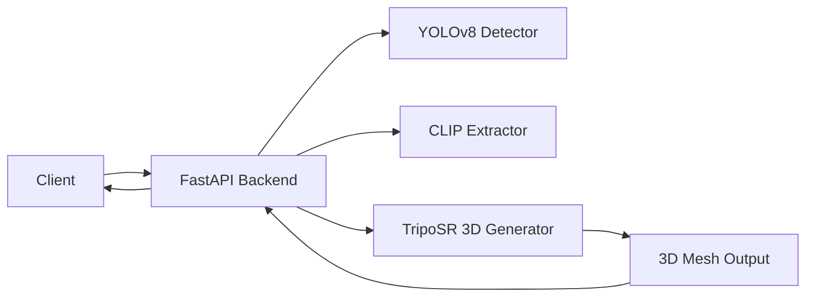

# Pet 3D Model Generator — Backend

End-to-end system that takes a pet photo, extracts visual attributes (breed, coat color, markings), and generates a 3D model using TripoSR.

## Table of Contents

- [Architecture](#architecture)
- [Installation](#installation)
- [Quick Start](#quick-start)
- [API Reference](#api-reference)
- [Inference Pipeline](#inference-pipeline)
- [Testing](#testing)
- [Dependency Troubleshooting](#dependency-troubleshooting)
- [Roadmap](#roadmap)

---

## Architecture

### Components

**Backend API** — FastAPI server handling image preprocessing, pet detection/cropping, attribute inference, and 3D model generation.

**ML Models:**
- **YOLOv8** — Pet detection and bounding box
- **CLIP** — Breed classification, color extraction, marking detection
- **TripoSR** — Image-to-3D model generation



### Data Flow

1. **Image Upload** → Client sends pet photo
2. **Pet Detection** → YOLOv8 detects and crops pet
3. **Attribute Extraction** → CLIP extracts breed, colors, markings
4. **3D Generation** → TripoSR generates 3D mesh from cropped image
5. **Model Export** → Mesh saved as GLB/OBJ/PLY/STL
6. **Response** → 3D model file returned to client

### Project Structure

```
backend/
├── app.py                  # FastAPI application with API endpoints
├── pipeline.py             # Main processing pipeline
├── model3d_generator.py    # TripoSR-based 3D model generation
├── pet_detector.py         # YOLOv8 pet detection
├── attribute_extractor.py  # CLIP-based attribute extraction
├── pet_profile.py          # Pet profile data model
├── prompt_builder.py       # Metadata prompt builder
├── requirements.txt        # Python dependencies
├── quick_test.py           # Automated testing script
├── models/                 # Generated 3D model output
├── static/test.html        # Web test interface
└── loras/                  # LoRA files (optional)
```

### Pet Profile Data Contract

```json
{
  "species": "dog",
  "breed": "Siberian Husky",
  "breed_confidence": 0.89,
  "coat_colors": ["black", "white"],
  "markings": ["facial mask"],
  "fur_length": "medium"
}
```

---

## Installation

### Prerequisites

- **Python 3.9, 3.10, or 3.11** (3.10 recommended)
- ~5 GB disk space (packages + models)
- GPU optional but recommended

### Step 1: Create Virtual Environment

```bash
cd pet_soul/backend

python -m venv venv
venv\Scripts\activate      # Windows
# source venv/bin/activate # Mac/Linux

python -m pip install --upgrade pip
```

### Step 2: Install Dependencies

```bash
pip install -r requirements.txt
```

### Step 3: Install TripoSR (from GitHub)

TripoSR is not on PyPI — install separately:

```bash
pip install git+https://github.com/VAST-AI-Research/TripoSR.git
```

### Step 4: Verify Installation

```bash
python -c "import torch; import transformers; import trimesh; print('All imports OK')"
python -c "from tsr.system import TSR; print('TripoSR OK')"
```

### GPU Support (Optional)

For NVIDIA GPU acceleration:

```bash
pip uninstall torch torchvision
pip install torch==2.1.0+cu118 torchvision==0.16.0+cu118 --index-url https://download.pytorch.org/whl/cu118
```

---

## Quick Start

```bash
# Start the server
python app.py

# Server starts at http://0.0.0.0:8000
```

First run will download models automatically (~1.5 GB for TripoSR, ~300 MB for CLIP, ~6 MB for YOLOv8).

### Test with Web Interface

Open http://localhost:8000/test in your browser.

### Test with curl

```bash
# Analyze a pet photo
curl -X POST http://localhost:8000/analyze-pet -F "file=@pet_photo.jpg"

# Generate a 3D model
curl -X POST "http://localhost:8000/generate-3d-model?format=glb&resolution=128" \
  -F "file=@pet_photo.jpg" -o pet_model.glb
```

### Test with Script

```bash
python quick_test.py path/to/pet_photo.jpg
```

---

## API Reference

### `POST /generate-3d-model`

Generate a 3D model from a pet photo.

| Parameter | Type | Default | Description |
|-----------|------|---------|-------------|
| `file` | multipart | required | Pet photo |
| `format` | query | `glb` | Output format: `glb`, `obj`, `ply`, `stl` |
| `resolution` | query | `256` | Marching cubes resolution: 128–512 |

**Returns:** 3D model file

### `POST /analyze-pet`

Detect pet and extract attributes (no 3D generation).

| Parameter | Type | Description |
|-----------|------|-------------|
| `file` | multipart | Pet photo |

**Returns:** JSON with pet profile (breed, colors, markings)

### `GET /health`

**Returns:** JSON system status (`pipeline_ready`, `detector_ready`, `generator_ready`)

### `GET /test`

Web test interface.

### Supported 3D Formats

| Format | Best For |
|--------|----------|
| **GLB** | Web/mobile (compact, includes textures) — recommended |
| **OBJ** | Widely compatible, simple text format |
| **PLY** | Colored meshes |
| **STL** | 3D printing |

---

## Inference Pipeline

### 1. Pet Detection (YOLOv8)

```python
image = load_image(path)
bbox = yolo.detect(image)
pet_crop = crop(image, bbox)
```

### 2. Attribute Extraction (CLIP)

```python
# Breed
scores = clip.rank(pet_crop, breed_prompts)
breed = max(scores)

# Coat color & markings
colors = clip.multi_label(pet_crop, color_prompts)
markings = clip.multi_label(pet_crop, marking_prompts)
```

### 3. 3D Model Generation (TripoSR)

```python
model = triposr.generate(pet_crop)
mesh = model.export(format="glb", resolution=256)
```

---

## Testing

### Backend Health Check

```bash
curl http://localhost:8000/health
```

Expected:
```json
{
  "status": "healthy",
  "pipeline_ready": true,
  "detector_ready": true,
  "generator_ready": true
}
```

### Test All Formats

```bash
curl -X POST "http://localhost:8000/generate-3d-model?format=glb&resolution=128" -F "file=@pet.jpg" -o pet.glb
curl -X POST "http://localhost:8000/generate-3d-model?format=obj&resolution=128" -F "file=@pet.jpg" -o pet.obj
curl -X POST "http://localhost:8000/generate-3d-model?format=ply&resolution=128" -F "file=@pet.jpg" -o pet.ply
curl -X POST "http://localhost:8000/generate-3d-model?format=stl&resolution=128" -F "file=@pet.jpg" -o pet.stl
```

### Viewing 3D Models

- **Windows 3D Viewer** — Right-click `.glb` → Open with → 3D Viewer
- **Online** — Drag `.glb` to https://gltf-viewer.donmccurdy.com/
- **Blender** — File → Import → glTF 2.0
- **MeshLab** — Supports all formats

### Performance Benchmarks

| Hardware | Res 128 | Res 256 | Res 512 |
|----------|---------|---------|---------|
| RTX 3080 | ~20s | ~45s | ~90s |
| RTX 2060 | ~30s | ~60s | ~120s |
| CPU (8-core) | ~120s | ~240s | ~480s |

---

## Dependency Troubleshooting

### huggingface_hub Version Conflict

If you see conflicting dependency errors between `transformers` and `huggingface_hub`:

The `requirements.txt` omits an explicit `huggingface_hub` version so pip can auto-resolve. If issues persist, install in order:

```bash
pip install numpy scipy pillow opencv-python
pip install torch==2.1.0 torchvision==0.16.0
pip install transformers==4.35.0 accelerate==0.24.1
pip install fastapi uvicorn[standard] ultralytics trimesh pygltflib networkx aiofiles python-dotenv safetensors python-multipart
pip install git+https://github.com/VAST-AI-Research/TripoSR.git
```

### "No module named 'tsr'"

```bash
pip install git+https://github.com/VAST-AI-Research/TripoSR.git
```

### "Failed building wheel"

Install Visual C++ Build Tools, or use conda:

```bash
conda create -n pet3d python=3.10
conda activate pet3d
conda install pytorch torchvision -c pytorch
pip install -r requirements.txt
pip install git+https://github.com/VAST-AI-Research/TripoSR.git
```

### CUDA Out of Memory

- Lower resolution to 128
- Force CPU: edit `model3d_generator.py` → `self.device = "cpu"`
- Close other GPU-consuming applications

### "No pet detected"

- Use a clear photo with good lighting
- Ensure the pet is the main subject
- Avoid cluttered backgrounds

### Version Compatibility

| Package | Tested Version | Minimum |
|---------|---------------|---------|
| Python | 3.10 | 3.9 |
| PyTorch | 2.1.0 | 2.0.0 |
| Transformers | 4.35.0 | 4.30.0 |
| FastAPI | 0.104.1 | 0.100.0 |
| Trimesh | 3.23.0+ | 3.20.0 |

---

## Roadmap

### Phase 1 — MVP (Current)
- Dog support with YOLO + CLIP
- TripoSR 3D model generation
- Multi-format export (GLB, OBJ, PLY, STL)

### Phase 2 — Quality
- Cat & mixed-breed support
- Marking heuristics
- Texture improvements

### Phase 3 — Production
- Feedback-based retraining
- Batch processing
- Mobile app integration

### Future Ideas
- Animated models
- AR filters
- Merchandise integration

---

## License

MIT (model licenses may vary)

All systems go. pipeline_ready: true — all three models (YOLO, CLIP, TripoSR) loaded successfully.

  The server is running at http://localhost:8000. You can now:                                                                            - Browse http://localhost:8000/test for the test page
  - Upload a pet photo to /analyze-pet or /generate-3d-model                                                                            
  To start the server in the future, use the pyenv venv:
  source .venv/bin/activate
  python app.py