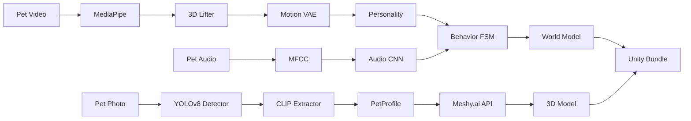

# PetSoul — Pet Digital Twin Platform

End-to-end system that transforms pet photos and videos into living digital twins: 3D models with personality, motion, and behavior powered by AI.

## Table of Contents

- [Architecture](#architecture)
- [Installation](#installation)
- [Quick Start](#quick-start)
- [API Reference](#api-reference)
- [Modules](#modules)
- [Configuration](#configuration)
- [Testing](#testing)
- [Troubleshooting](#troubleshooting)
- [Roadmap](#roadmap)

---

## Architecture

### Pipeline

```
Photo → YOLOv8 Detection → CLIP Attributes → PetProfile → Meshy.ai → GLB Model
Video → MediaPipe Pose → 3D Lifting → Motion VAE → Personality Profile
Audio → MFCC Features → CNN Classifier → Vocal Type + Emotion
All → Latent State → World Model → Behavior FSM → Unity Export
```



### Project Structure

```
PetSoul/
├── pet_soul/                      # Python package
│   ├── main.py                    # Entry point
│   ├── config/settings.py         # All configuration
│   ├── appearance/                # Photo → 3D model pipeline
│   │   ├── pipeline.py            # Orchestrator
│   │   ├── pet_detector.py        # YOLOv8 detection
│   │   ├── attribute_extractor.py # CLIP classification
│   │   ├── prompt_builder.py      # Texture prompt generation
│   │   ├── meshy_generator.py     # Meshy.ai API client
│   │   └── pet_profile.py         # PetProfile dataclass
│   ├── motion/                    # Video → motion analysis
│   │   ├── pose_extractor.py      # MediaPipe keypoints
│   │   ├── lift_2d_to_3d.py       # MLP depth prediction
│   │   ├── motion_autoencoder.py  # LSTM VAE
│   │   └── motion_features.py     # Handcrafted motion stats
│   ├── behavior/                  # Personality + state machine
│   │   ├── personality.py         # PersonalityProfile
│   │   └── state_machine.py       # Probabilistic FSM
│   ├── audio/                     # Audio classification
│   │   ├── feature_extractor.py   # MFCC extraction
│   │   └── audio_classifier.py    # 1D CNN classifier
│   ├── world_model/               # Predictive behavior
│   │   ├── latent_dynamics.py     # z(t+1) = f(z(t), action)
│   │   └── policy_network.py      # Reward + action selection
│   ├── runtime_export/            # Unity packaging
│   │   └── unity_exporter.py      # Bundle + ZIP export
│   ├── db/                        # Database + auth
│   │   ├── auth.py                # Auth0 JWT verification
│   │   └── supabase_client.py     # Supabase client
│   └── api/                       # FastAPI routes
│       ├── app.py                 # App + middleware
│       ├── routes_auth.py         # /auth/* endpoints
│       ├── routes_pets.py         # /pets/* endpoints
│       ├── routes_motion.py       # /motion/* endpoints
│       └── routes_export.py       # /export/* endpoints
├── frontend/                      # React frontend (Auth0 + Three.js)
│   ├── src/
│   │   ├── main.tsx               # Entry point (Auth0Provider)
│   │   ├── App.tsx                # All screens + Auth0 integration
│   │   ├── api.ts                 # Authenticated API wrapper
│   │   ├── App.css                # Minecraft theme styles
│   │   └── index.css              # Global styles + CSS variables
│   ├── vite.config.ts             # Vite + backend proxy
│   ├── .env.local                 # Auth0 env vars (gitignored)
│   └── package.json
├── dash_app/                      # Developer testing dashboard
│   ├── app.py                     # Dash app (port 8050)
│   ├── requirements.txt
│   └── tabs/                      # 12 model testing tabs
│       ├── tab_detector.py        # YOLOv8 detection test
│       ├── tab_attributes.py      # CLIP attribute test
│       ├── tab_pipeline.py        # Full pipeline test
│       ├── tab_pose.py            # MediaPipe pose test
│       ├── tab_motion_features.py # Motion stats radar chart
│       ├── tab_autoencoder.py     # LSTM VAE latent space
│       ├── tab_audio_classifier.py# Audio CNN test
│       ├── tab_audio_features.py  # Waveform + MFCC
│       ├── tab_fsm.py             # Interactive FSM
│       ├── tab_personality.py     # Personality radar chart
│       ├── tab_dynamics.py        # Latent dynamics rollout
│       └── tab_policy.py          # Policy action selection
├── tests/
├── static/                        # Web test UI
├── models/                        # Generated 3D output
├── requirements.txt
├── .env.example
└── CLAUDE.md
```

---

## Installation

### Prerequisites

- **Python 3.10+** (tested on 3.10.14)
- **Meshy.ai Pro** account (~$20/month) for 3D model generation
- **Auth0** account (free tier works) for authentication
- **Supabase** project (free tier works) for database
- ~4 GB RAM minimum (CLIP + YOLOv8)
- No GPU required — all 3D generation happens in Meshy.ai cloud

### Setup

```bash
# Clone and enter project
cd PetSoul

# Create virtual environment
python -m venv .venv
source .venv/bin/activate        # Linux/WSL/Mac
# .venv\Scripts\activate         # Windows

# Install dependencies
pip install -r requirements.txt

# Configure environment
cp .env.example .env
# Edit .env with your credentials:
#   MESHY_API_KEY    — from Meshy.ai dashboard
#   AUTH0_DOMAIN     — from Auth0 > Applications > Settings
#   AUTH0_AUDIENCE   — your Auth0 API identifier
#   AUTH0_CLIENT_ID  — from Auth0 > Applications > Settings
#   SUPABASE_URL     — from Supabase > Settings > API
#   SUPABASE_KEY     — Supabase anon or service role key
```

### Supabase Database Setup

Create these tables in your Supabase SQL editor:

```sql
CREATE TABLE users (
    id UUID PRIMARY KEY DEFAULT gen_random_uuid(),
    auth0_id TEXT UNIQUE NOT NULL,
    email TEXT,
    name TEXT,
    picture TEXT,
    created_at TIMESTAMPTZ DEFAULT NOW(),
    updated_at TIMESTAMPTZ DEFAULT NOW()
);

CREATE TABLE pets (
    id UUID PRIMARY KEY DEFAULT gen_random_uuid(),
    user_id TEXT NOT NULL,
    name TEXT NOT NULL,
    species TEXT,
    breed TEXT,
    profile JSONB,
    model_url TEXT,
    created_at TIMESTAMPTZ DEFAULT NOW()
);

CREATE TABLE motion_data (
    id UUID PRIMARY KEY DEFAULT gen_random_uuid(),
    pet_id UUID REFERENCES pets(id),
    motion_stats JSONB,
    latent_vector BYTEA,
    created_at TIMESTAMPTZ DEFAULT NOW()
);

CREATE TABLE personality_profiles (
    id UUID PRIMARY KEY DEFAULT gen_random_uuid(),
    pet_id UUID REFERENCES pets(id),
    profile JSONB,
    created_at TIMESTAMPTZ DEFAULT NOW()
);
```

---

## Quick Start

```bash
# 1. Start the backend API (port 8000)
python -m pet_soul.main

# 2. Start the React frontend (port 5173)
cd frontend
npm install
npm run dev

# 3. (Optional) Start the Dash dev dashboard (port 8050)
pip install -r dash_app/requirements.txt
python -m dash_app.app
```

First run will auto-download CLIP (~300 MB) and YOLOv8 Nano (~6.5 MB).

### Frontend

Open http://localhost:5173 — the React app with Auth0 login, pet collection, 3D model viewer, and video/audio upload.

The frontend requires Auth0 credentials in `frontend/.env.local`:
```
VITE_AUTH0_DOMAIN=your-tenant.auth0.com
VITE_AUTH0_CLIENT_ID=your_client_id
VITE_AUTH0_AUDIENCE=https://petsoul-api
```

Auth0 Application settings must list `http://localhost:5173` as an Allowed Callback URL, Allowed Logout URL, and Allowed Web Origin.

### Dev Dashboard

Open http://localhost:8050 — the Dash testing app with 12 tabs for testing each ML model individually (detector, attributes, pipeline, pose, motion, autoencoder, audio, FSM, personality, dynamics, policy).

### Test with curl

```bash
# Health check
curl http://localhost:8000/health

# Generate 3D model from photo (no auth required)
curl -X POST http://localhost:8000/generate-3d-model \
  -F "file=@pet_photo.jpg"

# Create a pet (auth required)
curl -X POST http://localhost:8000/pets/ \
  -H "Authorization: Bearer YOUR_AUTH0_TOKEN" \
  -H "Content-Type: application/json" \
  -d '{"name": "Buddy", "species": "dog"}'

# Analyze motion from video (auth required)
curl -X POST http://localhost:8000/motion/analyze-video \
  -H "Authorization: Bearer YOUR_AUTH0_TOKEN" \
  -F "file=@pet_video.mp4" \
  -F "pet_id=PET_UUID"

# Export Unity bundle (auth required)
curl -X POST http://localhost:8000/export/PET_UUID/unity \
  -H "Authorization: Bearer YOUR_AUTH0_TOKEN" \
  --output pet_bundle.zip
```

---

## API Reference

### Public Endpoints

| Method | Path | Description |
|---|---|---|
| `GET` | `/` | Server status |
| `GET` | `/health` | Component readiness check |
| `GET` | `/test` | Web test UI redirect |
| `POST` | `/generate-3d-model` | Photo → 3D model (no auth) |
| `GET` | `/auth/config` | Auth0 config for frontend SDK |

### Authenticated Endpoints

All require `Authorization: Bearer <Auth0_JWT>` header.

| Method | Path | Description |
|---|---|---|
| `GET` | `/auth/me` | Current user profile from token |
| `POST` | `/auth/sync` | Sync Auth0 user to Supabase |
| `GET` | `/pets/` | List user's pets |
| `POST` | `/pets/` | Create a pet |
| `GET` | `/pets/{id}` | Get pet details |
| `DELETE` | `/pets/{id}` | Delete a pet |
| `POST` | `/pets/{id}/generate` | Generate 3D model for a pet |
| `POST` | `/motion/analyze-video` | Analyze pet video for motion/personality |
| `POST` | `/motion/analyze-audio` | Classify pet audio (vocal type + emotion) |
| `GET` | `/motion/personality/{pet_id}` | Get personality profile |
| `POST` | `/export/{pet_id}/unity` | Download Unity bundle (.zip) |

---

## Modules

### Appearance (v1.0)
Photo → 3D model pipeline using YOLOv8 detection, CLIP attribute extraction, and Meshy.ai cloud generation. Outputs textured GLB files (15k–30k polygons).

### Motion (v2.1)
Video analysis using MediaPipe pose extraction, MLP-based 2D→3D lifting, LSTM VAE for motion encoding, and handcrafted feature extraction (speed, entropy, tail wag frequency, gait regularity).

### Behavior (v2.2)
Probabilistic finite state machine (Idle/Curious/Playful/Alert/Resting) with weighted transitions driven by sensory input. PersonalityProfile derived from motion + audio analysis.

### Audio (v2.2)
MFCC feature extraction + 1D CNN classifier. Detects vocal type (bark, meow, whine, growl, purr, silence) and emotion (calm, excited, anxious, playful).

### World Model (v3.0)
Latent dynamics model predicting future states. Policy network selects actions via imagination rollouts scored by a reward predictor. Actions: stay, approach, retreat, play, rest.

### Runtime Export
Packages 3D model + personality + motion + animation curves into a Unity-ready ZIP bundle.

---

## Configuration

All settings are in `pet_soul/config/settings.py` as a frozen dataclass. Key values:

| Setting | Default | Description |
|---|---|---|
| `yolo_conf_threshold` | 0.25 | Detection confidence |
| `clip_model_name` | `openai/clip-vit-base-patch32` | CLIP model |
| `meshy_ai_model` | `meshy-6` | Meshy.ai model version |
| `meshy_timeout` | 600s | Max wait for 3D generation |
| `default_output_format` | `glb` | 3D output format |
| `host` / `port` | `0.0.0.0` / `8000` | Server binding |

Environment variables (set in `.env`):
- `MESHY_API_KEY` — Meshy.ai API key
- `AUTH0_DOMAIN` — Auth0 tenant domain
- `AUTH0_AUDIENCE` — Auth0 API audience
- `AUTH0_CLIENT_ID` — Auth0 application client ID
- `SUPABASE_URL` — Supabase project URL
- `SUPABASE_KEY` — Supabase API key

---

## Testing

### Health Check

```bash
curl http://localhost:8000/health
```

Expected:
```json
{
  "status": "healthy",
  "pipeline_ready": true,
  "detector_ready": true,
  "generator_ready": true,
  "supabase_ready": true
}
```

### Viewing 3D Models

- **Online** — Drag `.glb` to https://gltf-viewer.donmccurdy.com/
- **Blender** — File > Import > glTF 2.0
- **Windows 3D Viewer** — Right-click `.glb` > Open with > 3D Viewer

---

## Troubleshooting

### "No pet detected"
- Use a clear photo with good lighting
- Ensure the pet is the main subject
- Avoid cluttered backgrounds

### Meshy.ai timeout
- 3D generation takes 1–3 minutes per model
- Timeout is set to 600s — increase `meshy_timeout` in config if needed
- Check your Meshy.ai account quota

### CLIP model download fails
- CLIP auto-downloads ~300 MB on first run
- Ensure internet access and sufficient disk space
- Model caches to HuggingFace cache directory

### Import errors
- Ensure you're using the project venv: `source .venv/bin/activate`
- Run `pip install -r requirements.txt` to install all dependencies

---

## Roadmap

### Completed
- **v1.0** — Photo → 3D model pipeline (YOLOv8 + CLIP + Meshy.ai)
- **v2.0** — Codebase modularization into `pet_soul/` package
- **v2.1** — Motion analysis (MediaPipe + 3D lifting + LSTM VAE)
- **v2.2** — Behavior engine (FSM + personality) and audio classification
- **v3.0** — World model (latent dynamics + policy network) and Unity export

### Next
- Train motion VAE and audio CNN on real pet datasets
- Unity iOS app integration
- Cat breed classification
- Real-time webcam motion capture
- Multi-pet support

---

## Tech Stack

| Component | Technology |
|---|---|
| Backend | FastAPI + Uvicorn |
| Frontend | React 19 + TypeScript + Vite |
| 3D Viewer | React Three Fiber + Three.js |
| Dev Dashboard | Dash + Plotly |
| Detection | YOLOv8 Nano |
| Classification | CLIP ViT-base-32 |
| 3D Generation | Meshy.ai cloud API |
| Motion | MediaPipe + PyTorch (MLP, LSTM VAE) |
| Audio | librosa + PyTorch (1D CNN) |
| Auth | Auth0 (RS256 JWT) |
| Database | Supabase (PostgreSQL) |
| Deep Learning | PyTorch 2.1+, Transformers 4.35+ |

---

## License

MIT (model licenses may vary)
